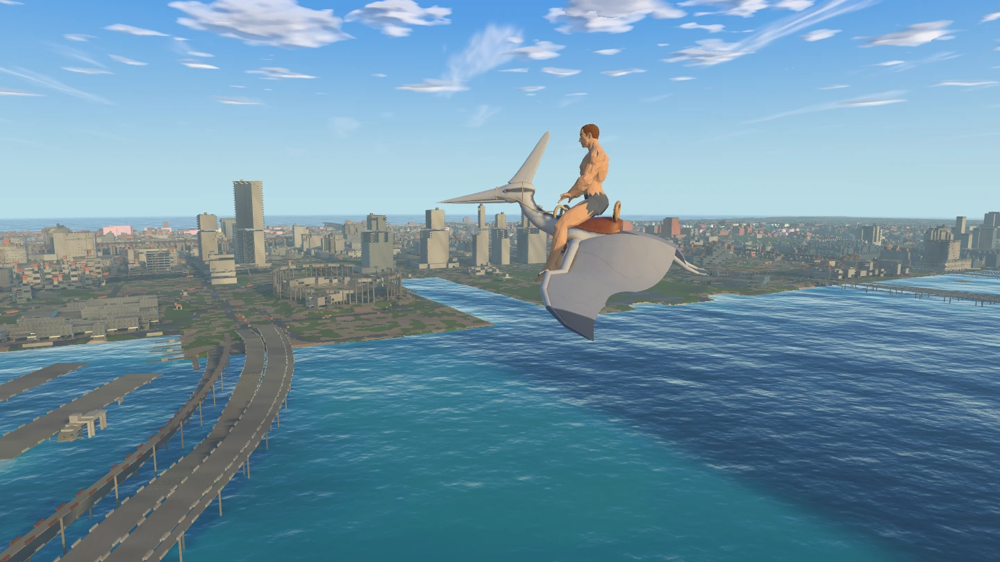

# SNARK · Miami Devolved

ARK-style dinosaur survival and GTA-style vehicles in a persistent multiplayer browser game.

- **Five real cities** · Miami, Tampa, Las Vegas, Los Angeles, San Francisco. About 66 km² each.
- **Survival** · Form tribes, unlock engrams, craft gear, snap bases together. Knock out, tame, breed and ride dinosaurs.
- **Vehicles** · Eight road models, jet skis, yachts and helicopters. Passengers, cargo, fuel and persistent parking.
- **Multiplayer** · Client-predicted movement, lag-compensated hits, crash-safe survivor and gear transfers between servers.
- **Engine** · Native WebGL 2, TypeScript on Bun, zero runtime dependencies. An iPhone benchmark hit a 17 ms median frame at minute ten with 800 bodies.
- **Modding** · Content packs define creatures and engrams. ARK-style INIs tune servers. MCP agents harvest, craft and ride as players.

**Run locally** `bun install --frozen-lockfile && bun run dev` → `localhost:8787`

[Map pipeline](tools/maps/README.md) · [Art & downloads](distribution/README.md) · [Agent setup](agent/README.md#run-it) · [Benchmarks](planning/quality/performance.md) · [Code license](LICENSE)
